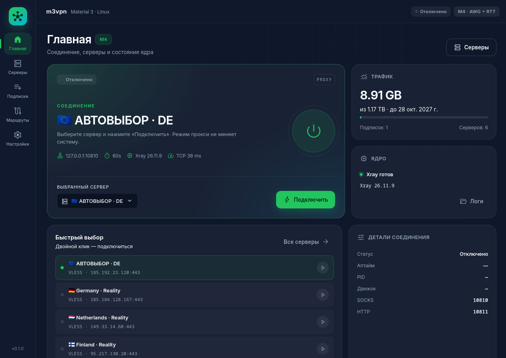
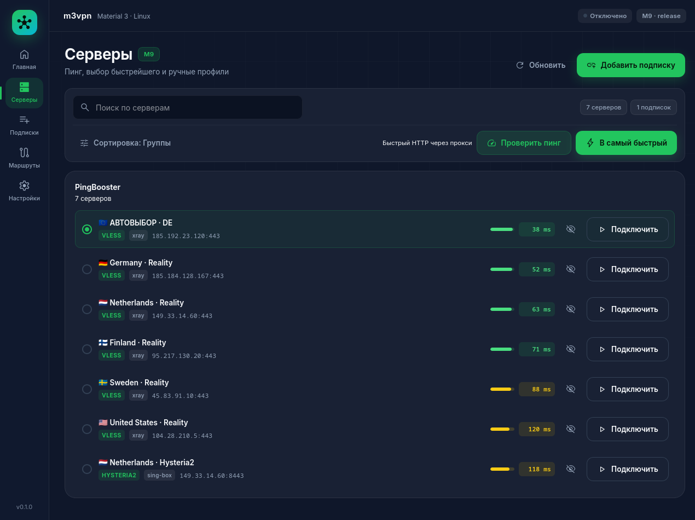
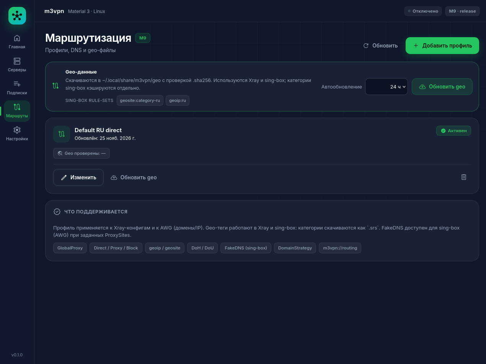
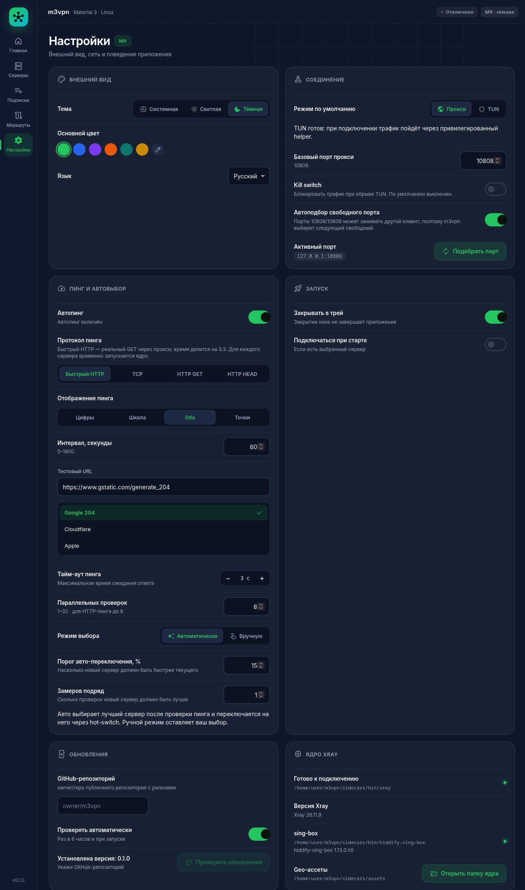

<p align="center">
  
</p>

<h1 align="center">m3vpn</h1>

<p align="center">
  Material 3 VPN-клиент для Linux: Xray, sing-box, Reality, Hysteria 2,
  AmneziaWG, TUN и маршрутизация без потери интернета.
</p>

<p align="center">
  <a href="https://github.com/nikitaakbaev/m3vpn/actions/workflows/ci.yml">
    
  </a>
  <a href="https://github.com/nikitaakbaev/m3vpn/releases/latest">
    
  </a>
  <a href="https://github.com/nikitaakbaev/m3vpn/releases">
    
  </a>
  
  <a href="LICENSE">
    
  </a>
</p>

<p align="center">
  
</p>

## Возможности

- **Material 3 UI** — тёмная и светлая темы, акцентный цвет, адаптивная сетка.
- **Два ядра** — Xray и Hiddify sing-box выбираются автоматически по протоколу.
- **Протоколы** — VLESS, Reality, Hysteria 2, TUIC, AmneziaWG, SOCKS/HTTP.
- **Подписки** — импорт по URL, обновление, трафик и срок действия.
- **TUN-режим** — привилегированный helper, watchdog и опциональный kill switch.
- **Fail-open** — при остановке или падении helper маршруты и интернет
  восстанавливаются без ручных команд.
- **Маршрутизация** — direct/proxy/block по доменам и IP, DoH/DoU,
  `geoip:` / `geosite:`, sing-box rule-sets, geo-файлы Global или Россия.
- **Быстрый выбор** — Fast HTTP ping, автопереключение с причиной,
  исключения серверов, фильтры и массовые действия.
- **Обновления** — приложение, Xray и sing-box проверяются через GitHub
  Releases; артефакты сопровождаются `SHA256SUMS`.
- **Упаковка** — Arch-пакет, Debian-пакет и portable tar.gz.

## Скриншоты

<p align="center">
  
  
</p>
<p align="center">
  
  
</p>

## Установка

### Arch / CachyOS

Скачай `.pkg.tar.zst` из [последнего релиза](https://github.com/nikitaakbaev/m3vpn/releases/latest):

```bash
sudo pacman -U m3vpn-0.2.0-1-x86_64.pkg.tar.zst
sudo systemctl enable --now m3vpn-helper
sudo usermod -aG m3vpn "$USER"
```

После добавления в группу **перелогинься**, чтобы TUN заработал.

### Debian / Ubuntu

```bash
sudo apt install ./m3vpn_0.2.0-1_amd64.deb
```

### Portable

Portable-архив содержит готовое дерево `/usr`:

```bash
sudo tar -xzf m3vpn-0.2.0-linux-x86_64.tar.gz -C /
sudo systemctl enable --now m3vpn-helper
```

### Проверка артефактов

```bash
sha256sum -c SHA256SUMS
```

## Обновления

**Настройки → Обновления** проверяют последний публичный GitHub Release.
Приложение не хранит токенов и не устанавливает пакеты автоматически:
показывает версию, заметки и ссылки на артефакты.

**Настройки → Версии ядер** отдельно проверяет Xray и sing-box. Скачанные
ядра кладутся в `~/.local/share/m3vpn/cores`, проверяются по SHA-256 и
используются прокси-бэкендами. TUN-ядро helper'а остаётся встроенным в пакет:
helper запускает его от root, поэтому пользовательские бинарники туда не
допускаются.

**Маршруты → Geo-данные → Источник** переключает `Global` (Loyalsoldier) и
`Россия` (`runetfreedom/russia-v2ray-rules-dat`). Файлы проверяются по
`.sha256` / `.sha256sum`.

## Архитектура

```text
┌──────────────────────────────┐
│  Tauri 2 + React + Material 3│
│  SQLite, настройки, трей     │
└──────────────┬───────────────┘
               │
       ┌───────┴────────┐
       │  front proxy   │  sing-box, локальный SOCKS/HTTP
       └───────┬────────┘
               │
       ┌───────┴────────┐
       │    backend     │  Xray или Hiddify sing-box
       └───────┬────────┘
               │
       ┌───────┴────────┐
       │ m3vpn-helper   │  root: TUN, маршруты, nftables
       │ systemd socket │  cgroup-маркировка прокси
       └────────────────┘
```

Прокси-ядра запускаются непривилегированно и наследуют systemd-cgroup
приложения. Helper помечает эту cgroup через nftables, чтобы транспорт
front/backend не заворачивался обратно в TUN. `SO_MARK` из непривилегированного
процесса не используется; TUN-ядро запускается helper'ом от root и ставит
`route.default_mark` само.

## Разработка

Нужны Rust, Node.js, Go и системные зависимости Tauri/WebKitGTK.

```bash
# ядра и geo-ассеты
bash scripts/build-sidecars.sh
bash scripts/check-sidecars.sh

# приложение
cd apps/desktop
npm install
npm run tauri dev
```

### Проверки

```bash
(cd apps/desktop/src-tauri && cargo clippy --all-targets -- -D warnings && cargo test)
(cd crates/helper && cargo test)
(cd crates/parser && cargo test)
(cd apps/desktop && npm run typecheck && npm run build)
bash scripts/spikes/helper_netns_test.sh
```

### Сборка пакетов

```bash
bash scripts/package-arch.sh
```

Результат в `dist/`:

```text
m3vpn-0.2.0-1-x86_64.pkg.tar.zst
m3vpn_0.2.0-1_amd64.deb
m3vpn-0.2.0-linux-x86_64.tar.gz
SHA256SUMS
```

## Дорожная карта

- **P4** — `.rpm`, AppImage, AUR, подписи артефактов.
- **P6** — Android: `VpnService`, foreground service, per-app split tunneling.
- **P7** — Windows: Wintun, служба маршрутов/firewall, подпись драйвера.

Подробно: [`docs/roadmap.md`](docs/roadmap.md).

## Документация

- [P1 — TUN и сеть](docs/p1-report.md)
- [P3 — routing, DNS и rule-sets](docs/p3-report.md)
- [P4 — упаковка и обновления](docs/p4-report.md)
- [План фронтенд-рефакторинга](docs/frontend-refactor-plan.md)
- [Использованные skills](docs/skills.md)

## Лицензия

MIT. Сторонние ядра и geo-данные распространяются по своим лицензиям; см.
[`packaging/linux/THIRD-PARTY.md`](packaging/linux/THIRD-PARTY.md).
